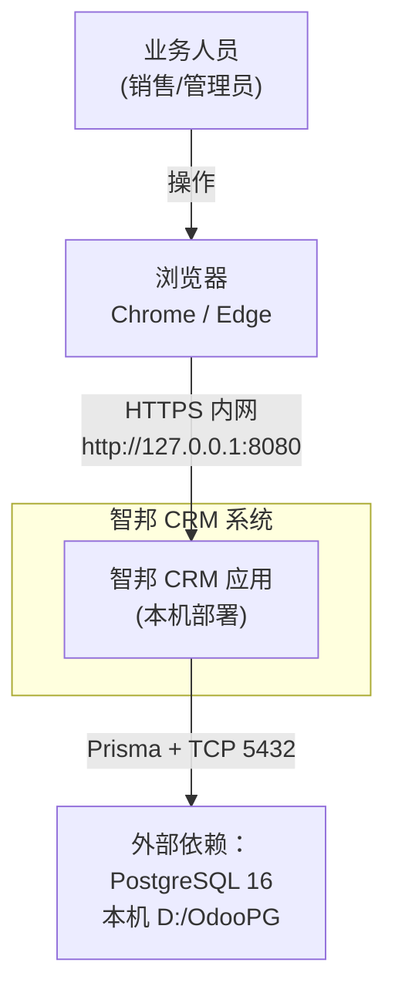
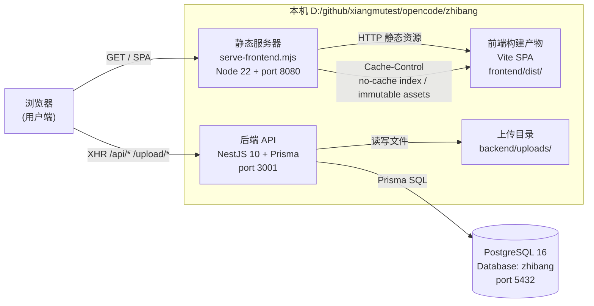
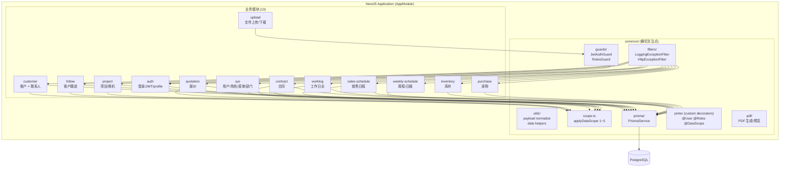
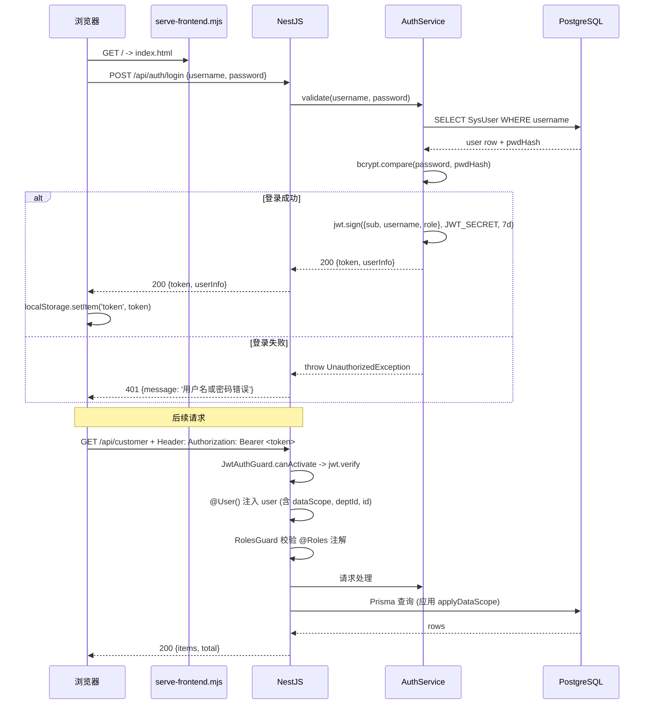
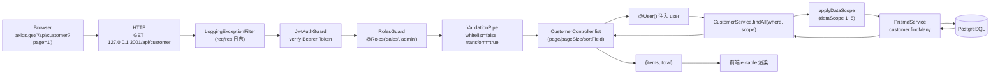

# 智邦 CRM 架构图

> 让新人一眼看懂系统全貌。采用 [C4 模型](https://c4model.com/)（System Context / Container / Component）+ 关键数据流图。
> 所有图使用 [mermaid](https://mermaid.js.org/) 语法（GitHub 原生渲染）。

## 目录

- [1. C4 L1 — 系统上下文（System Context）](#1-c4-l1--系统上下文)
- [2. C4 L2 — 容器（Container）](#2-c4-l2--容器)
- [3. C4 L3 — 组件（Component）](#3-c4-l3--组件)
- [4. 关键数据流](#4-关键数据流)
- [5. 常用端口与启动](#5-常用端口与启动)
- [6. 当前限制与未来扩展](#6-当前限制与未来扩展)

---

## 1. C4 L1 — 系统上下文

**视角**：智邦 CRM 部署在一个内部办公环境里，对外不直接暴露。

**当前实际部署：**
- 数据库：**PostgreSQL 16**（本机 `D:\OdooPG`，由 `pg_ctl` 启停）。
- 网络：**纯内网 / 本机**，用户访问 `http://127.0.0.1:8080`。
- 用户角色：销售（sales01~sales05）、管理员（admin、sysadmin）。

**当前没有：** Cloudflare Tunnel、Redis（见 [第 6 节](#6-当前限制与未来扩展)）。

---

## 2. C4 L2 — 容器

**视角**：智邦 CRM 内部由几个独立的进程 / 进程组组成。

**关键设计：**
- 前端用 Vite 构建成 `frontend/dist/`，由 `serve-frontend.mjs` 提供静态访问（port 8080）。
  - `index.html` 设置 `Cache-Control: no-cache, no-store, must-revalidate`（避免发布后用户看到旧入口）。
  - `assets/*` 设置 `public, max-age=31536000, immutable`（hash 文件名天然长效缓存）。
- 后端 NestJS API 监听 `port 3001`，全局 `/api` 前缀；`/api/docs` 是 Swagger UI。
- 上传文件统一走 `UploadController`，不再用 NestJS 静态中间件（避免覆盖 Content-Disposition 处理中文文件名）。
- 数据库用 PostgreSQL 16.4，单库 `zhibang`（owner=`zhibang_app`）。

---

## 3. C4 L3 — 组件

**视角**：NestJS 内部的 13 个业务模块 + common 子系统。

**13 个业务模块清单：**

| 模块 | 路径 | 主要职责 |
|---|---|---|
| auth | `backend/src/modules/auth/` | 登录、JWT 签发/校验、profile |
| sys | `backend/src/modules/sys/` | 用户/角色/菜单/部门/操作权限 |
| customer | `backend/src/modules/customer/` | 客户 + 联系人（继承） |
| follow | `backend/src/modules/follow/` | 客户跟进（按客户） |
| project | `backend/src/modules/project/` | 项目/商机（CrmOpportunity） |
| quotation | `backend/src/modules/quotation/` | 报价单 |
| contract | `backend/src/modules/contract/` | 销售合同 |
| worklog | `backend/src/modules/worklog/` | 工作日志（日报） |
| weekly-schedule | `backend/src/modules/weekly-schedule/` | 周程 + 周总结 + 周计划 |
| sales-schedule | `backend/src/modules/sales-schedule/` | 销售日程管理 |
| inventory | `backend/src/modules/inventory/` | 库存 |
| purchase | `backend/src/modules/purchase/` | 采购 |
| upload | `backend/src/modules/upload/` | 文件上传 / 下载 / 预览 |

**common/ 横切子系统：**
- `guards/` — `JwtAuthGuard`（验 Bearer Token）、`RolesGuard`（按角色拦截）
- `filters/` — 全局异常过滤器（JSON + 完整堆栈）
- `utils/` — `payload.ts`（请求体归一化，跳过 `Prisma.Decimal` / `Date`）、日期 helper
- `scope.ts` — `applyDataScope(prisma, user, baseWhere)` 数据范围过滤（1~5）
- `prisma/prisma.service.ts` — PrismaClient 单例，注入所有 service
- `pinter/` — 自定义装饰器（`@User()` / `@Roles()` / `@DataScope()`）
- `pdf/` — PDF 生成/预览支持

---

## 4. 关键数据流

### 4.1 登录认证流

### 4.2 CRUD 请求流（典型）

**关键拦截器/中间件的执行顺序：**
1. CORS（`enableCors({origin:true, credentials:true})`）
2. 请求日志（`[REQ] [RES]` 输出）
3. 静态资源 / SPA fallback（仅当路径不在 `/api` `/upload`）
4. `ValidationPipe`（body 转 DTO）
5. `JwtAuthGuard`（解析 Bearer Token）
6. `RolesGuard`（按角色拒绝）
7. Controller 业务方法
8. `LoggingExceptionFilter`（5xx 时打印完整堆栈）

---

## 5. 常用端口与启动

| 服务 | 端口 | 启动方式 | 进程身份 |
|---|---|---|---|
| PostgreSQL | 5432 | `D:/OdooPG/bin/pg_ctl.exe -D D:/OdooPG/data start` | 本机 |
| 后端 NestJS | 3001 | `backend/start-backend.bat` → `npm run start` | 本机 user |
| 前端静态 | 8080 | `start-frontend.bat` → `node serve-frontend.mjs`（cwd=项目根） | 本机 user |
| Swagger UI | 3001 | 集成在 NestJS → `http://localhost:3001/api/docs` | — |

**一键启停：** `restart-zhibang.bat`（杀旧进程 + 启动 PG + 启动后端 + 启动前端 + 健康检查）

---

## 6. 当前限制与未来扩展

| 项目 | 当前状态 | 未来规划 | 文档 |
|---|---|---|---|
| 公网访问 | 仅内网 | Cloudflare Tunnel（暴露 3001 / 8080） | `ziliao/公网方案.md` |
| 缓存层 | 无 | Redis（session / 热点数据） | `20260828改进点.md` |
| 全文搜索 | LIKE 模糊匹配 | PG `tsvector` 或 ES | — |
| 多端登录 | 单设备 | JWT refresh + 多端会话表 | — |
| 操作日志 | SysOperLog / SysLoginLog 表已建但中间件未启用 | 加全局拦截器写日志 | — |

> 这些条目仅作为"目标态"参考，本图 L1/L2/L3 描述的是当前真实部署状态。

---

## 7. 相关文档

- `docs/database-er.md` — 数据库 ER 图（4.2）
- `docs/api.md` — API 文档补充（4.3）
- `docs/api.swagger.yml` — Swagger 自动导出（4.3）
- `backend/README.md` — 后端启动 / 测试
- `ziliao/公网方案.md` — 公网部署方案（Cloudflare Tunnel 等）