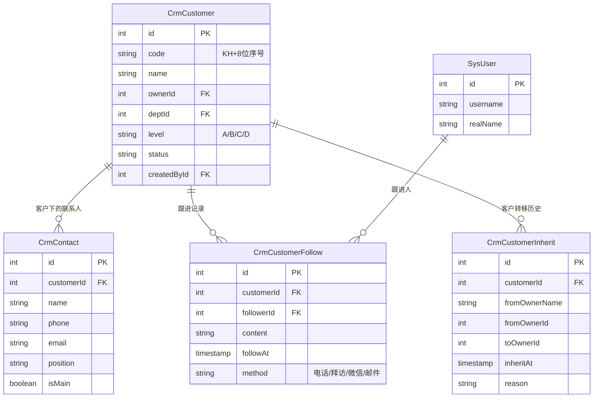
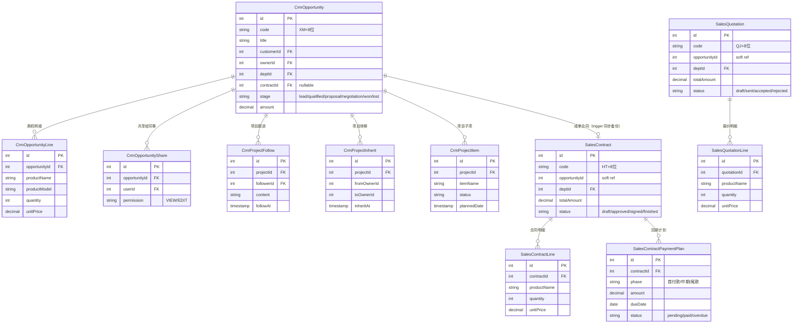
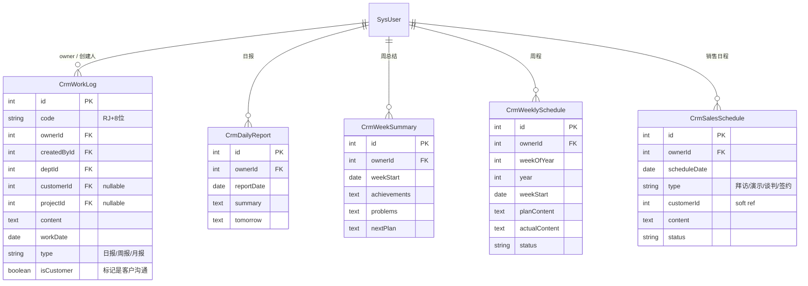
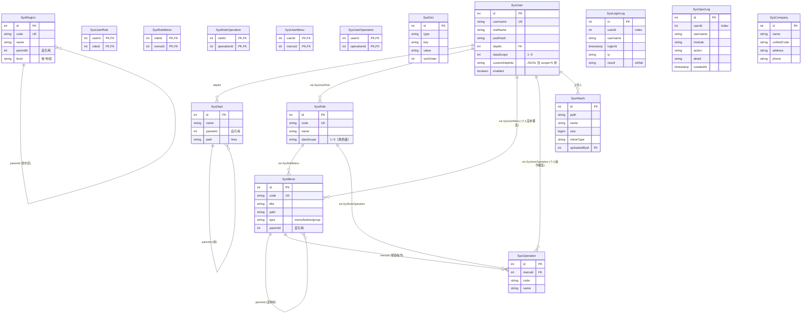
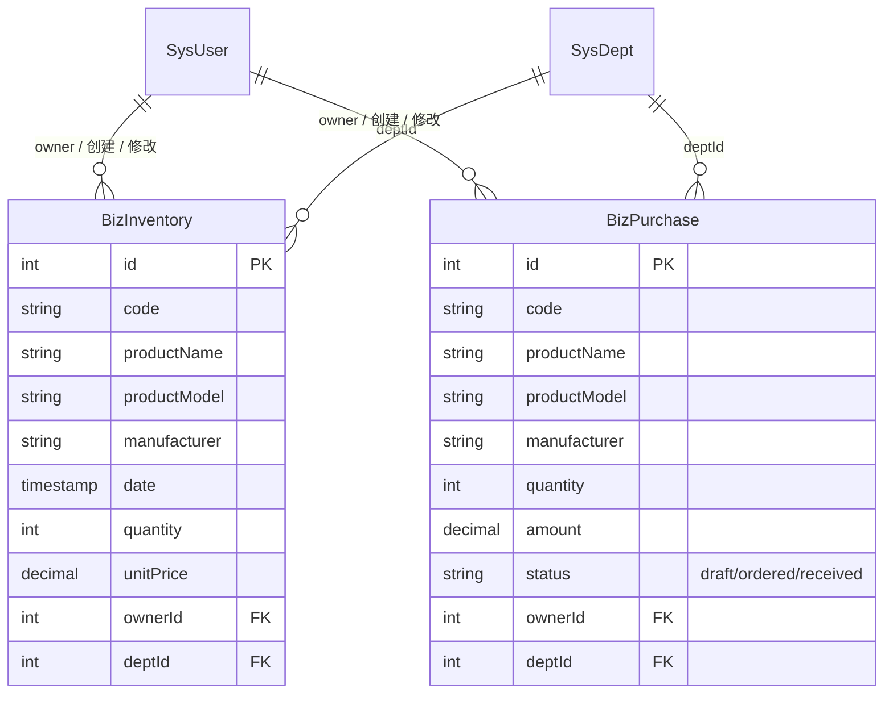

# 智邦 CRM 数据库 ER 图

> 让开发者快速理解 38 张业务/系统表的关系。所有图使用 [mermaid erDiagram](https://mermaid.js.org/syntax/erDiagram.html) 语法。
> 数据源：当前生产库 `zhibang`（PG 16.4），由 `information_schema` + FK 约束实时抽取。

## 目录

- [1. 总览（38 张业务表）](#1-总览)
- [2. 子图 1：客户-跟进-联系人-继承](#2-子图-1客户-跟进-联系人-继承)
- [3. 子图 2：项目-商机-报价-合同](#3-子图-2项目-商机-报价-合同)
- [4. 子图 3：工作日志-周报-日报-日程](#4-子图-3工作日志-周报-日报-日程)
- [5. 子图 4：系统-用户-角色-菜单-权限-部门](#5-子图-4系统-用户-角色-菜单-权限-部门)
- [6. 子图 5：业务-库存-采购](#6-子图-5业务-库存-采购)
- [7. 每张表的关键字段速查](#7-每张表的关键字段速查)

---

## 1. 总览

**38 张业务/系统表 + 1 张 `_prisma_migrations`**（Prisma 元表，不画入业务图）。

| 前缀 | 表数 | 主要内容 |
|---|---|---|
| Sys* | 16 | 系统（用户/角色/菜单/部门/操作/日志/字典/省市区） |
| Crm* | 15 | CRM 客户/跟进/项目/商机/工作日志/周报 |
| Sales* | 5 | 销售合同/报价 |
| Biz* | 2 | 库存/采购 |

```mermaid
erDiagram
    SysUser ||--o{ SysDept : "deptId"
    SysUser ||--o{ SysRole : "via SysUserRole"
    SysUser ||--o{ SysMenu : "via SysUserMenu"
    SysUser ||--o{ SysOperation : "via SysUserOperation"
    SysRole ||--o{ SysMenu : "via SysRoleMenu"
    SysRole ||--o{ SysOperation : "via SysRoleOperation"
    SysMenu ||--o{ SysOperation : "menuId"
    SysDept ||--o{ SysDept : "parentId"
    SysRegion ||--o{ SysRegion : "parentId"

    SysUser ||--o{ CrmCustomer : "ownerId"
    SysUser ||--o{ CrmCustomer : "createdById"
    SysUser ||--o{ CrmCustomer : "updatedById"
    SysDept ||--o{ CrmCustomer : "deptId"
    CrmCustomer ||--o{ CrmContact : "customerId"
    CrmCustomer ||--o{ CrmCustomerFollow : "customerId"
    CrmCustomer ||--o{ CrmCustomerInherit : "customerId"

    SysUser ||--o{ CrmOpportunity : "ownerId"
    SysUser ||--o{ CrmOpportunity : "createdById"
    SysDept ||--o{ CrmOpportunity : "deptId"
    CrmCustomer ||--o{ CrmOpportunity : "customerId"
    CrmOpportunity ||--o{ SalesContract : "contractId"
    CrmOpportunity ||--o{ CrmOpportunityLine : "opportunityId"
    CrmOpportunity ||--o{ CrmOpportunityShare : "opportunityId"
    SysUser ||--o{ CrmOpportunityShare : "userId"
    CrmOpportunity ||--o{ CrmProjectFollow : "projectId"
    SysUser ||--o{ CrmProjectFollow : "followerId"
    CrmOpportunity ||--o{ CrmProjectInherit : "projectId"
    CrmOpportunity ||--o{ CrmProjectItem : "projectId"
    SalesQuotation ||--o{ SalesQuotationLine : "quotationId"
    SysDept ||--o{ SalesQuotation : "deptId"
    SalesContract ||--o{ SalesContractLine : "contractId"
    SalesContract ||--o{ SalesContractPaymentPlan : "contractId"
    SysDept ||--o{ SalesContract : "deptId"

    SysUser ||--o{ CrmWorkLog : "ownerId"
    SysUser ||--o{ CrmWorkLog : "createdById"
    SysDept ||--o{ CrmWorkLog : "deptId"
    CrmCustomer ||--o{ CrmWorkLog : "customerId"
    CrmOpportunity ||--o{ CrmWorkLog : "projectId"
    SysUser ||--o{ CrmDailyReport : "ownerId"
    SysUser ||--o{ CrmWeekSummary : "ownerId"
    SysUser ||--o{ CrmWeeklySchedule : "ownerId"
    SysUser ||--o{ CrmSalesSchedule : "ownerId"

    SysUser ||--o{ BizInventory : "ownerId"
    SysUser ||--o{ BizInventory : "createdById"
    SysUser ||--o{ BizInventory : "updatedById"
    SysDept ||--o{ BizInventory : "deptId"
    SysUser ||--o{ BizPurchase : "ownerId"
    SysUser ||--o{ BizPurchase : "createdById"
    SysUser ||--o{ BizPurchase : "updatedById"
    SysDept ||--o{ BizPurchase : "deptId"
```

> 简版 ER 不含列定义，避免节点过多；详细字段见各子图 + [第 7 节速查表](#7-每张表的关键字段速查)。

---

## 2. 子图 1：客户-跟进-联系人-继承

**业务约定：**
- `CrmCustomer.code` 由 PG SEQUENCE `customer_code_seq` 自动生成，格式 `KH + YYYYMMDD + 4位序号`（如 `KH202608270002`）。
- `isMain` 标记主联系人，每个客户可有 1 个主联系人。
- `CrmCustomerInherit` 是**追加历史**而非覆盖：每次客户换 owner 都新增一条记录。
- 跟进内容 `content` 支持 markdown 文本。
- `dataScope` 1~5 过滤会应用到 `CrmCustomer`、`CrmCustomerFollow`、`CrmCustomerInherit`、`CrmContact` 的列表接口。

---

## 3. 子图 2：项目-商机-报价-合同

**业务约定：**
- `CrmOpportunity.code` 由 `project_code_seq` 生成；`SalesQuotation.code` 用 `quotation_code_seq`；`SalesContract.code` 用 `contract_code_seq`。
- **关键：商机 customerId 同步 trigger** `trg_sync_opportunity_customer` 在 PG 层同步 `customerCode` → `customerId`（防止历史孤儿数据）。函数：`pgtrigger.sync_opportunity_customer()`。
- `SalesContract.opportunityId` 是**软引用**（应用层维护），不在 schema 的 FK 列表里——因为商机可能不产生合同。
- 合同/报价只关联部门（`deptId`），不直接关联 owner；owner 通过 dept 间接约束。
- `SalesContractPaymentPlan` 支持按阶段回款（首付款 / 中期 / 尾款 / 验收款），逾期判定由后端定时任务计算。

---

## 4. 子图 3：工作日志-周报-日报-日程

**业务约定：**
- 工作日志 `code` 由 `worklog_code_seq` 生成（PJ=工作日志，但实际代码用 `RJ` 前缀）。
- `workDate` 是日期（非 timestamp），便于按日聚合。
- `CrmCustomerFollow` 与 `CrmWorkLog` 的区别：follow 强绑定客户（CrmCustomer.customerId 必填），worklog 可独立存在（只是顺便提到了客户/项目）。
- 周程 vs 周总结：CrmWeeklySchedule 是**计划**（提前一周填），CrmWeekSummary 是**总结**（周末填）。
- `CrmSalesSchedule` 是销售专属日程（更细粒度：拜访/演示/谈判/签约）。

---

## 5. 子图 4：系统-用户-角色-菜单-权限-部门

**权限模型要点：**
- **双重授权**：角色权限（SysRoleMenu / SysRoleOperation）+ 个人权限覆盖（SysUserMenu / SysUserOperation）。
- 实际生效规则：用户拥有的权限 = 角色权限 ∪ 个人权限（个人可加可减）。
- `SysOperation` 是按钮/操作级（路由级别），如 `customer:export`、`worklog:delete`。
- `SysUser.role.xpScope` / `SysUser.dataScope` / `SysUser.customDeptIds` 三者一起决定数据范围（见 `applyDataScope` in `common/scope.ts`）。

**日志与字典：**
- `SysLoginLog` / `SysOperLog` 表已建，但**中间件尚未启用**，目前为空表（生产需补全局拦截器写日志）。
- `SysDict` 存系统字典（如"客户等级"、"跟进方式"）。
- `SysRegion` 是省市区三级联动数据源（3806 行）。

---

## 6. 子图 5：业务-库存-采购

**业务约定：**
- 库存和采购是独立模块，目前**没有 BizPurchase → BizInventory 的自动入库**关联，需手动操作。
- 两者都支持 `applyDataScope`（按部门/本人过滤）。

---

## 7. 每张表的关键字段速查

### 7.1 Sys 系统表（16 张）

| 表 | 用途 | PK | 关键 FK | 关键字段 | 备注 |
|---|---|---|---|---|---|
| SysUser | 系统用户 | id | deptId→SysDept, (via SysUserRole→SysRole) | username(UK), realName, pwdHash, dataScope, customDeptIds(JSON) | dataScope 1~5，customDeptIds 仅 scope=5 用 |
| SysDept | 部门 | id | parentId→SysDept | name, path(ltree) | 自引用树形结构 |
| SysRole | 角色 | id | — | code(UK), name, dataScope | dataScope 角色级 |
| SysMenu | 菜单 | id | parentId→SysMenu | code(UK), title, path, type(menu/button/group) | 自引用树形 |
| SysOperation | 按钮/操作 | id | menuId→SysMenu | code, name | 路由级别权限 |
| SysUserRole | 用户-角色 | (userId, roleId) | userId→SysUser, roleId→SysRole | — | 联合主键 |
| SysRoleMenu | 角色-菜单 | (roleId, menuId) | roleId→SysRole, menuId→SysMenu | — | 联合主键 |
| SysRoleOperation | 角色-操作 | (roleId, operationId) | roleId→SysRole, operationId→SysOperation | — | 联合主键 |
| SysUserMenu | 用户-菜单 | (userId, menuId) | userId→SysUser, menuId→SysMenu | — | 个人菜单覆盖（加） |
| SysUserOperation | 用户-操作 | (userId, operationId) | userId→SysUser, operationId→SysOperation | — | 个人操作覆盖 |
| SysDict | 系统字典 | id | — | type, key, value, sortOrder | 枚举值 |
| SysRegion | 省市区 | id | parentId→SysRegion | code(UK), name | 3806 行，三级 |
| SysLoginLog | 登录日志 | id | userId→SysUser(idx) | username, ip, loginAt, result | **未启用** |
| SysOperLog | 操作日志 | id | userId→SysUser(idx) | module, action, detail, createdAt | **未启用** |
| SysAttach | 附件 | id | uploadedById→SysUser | path, name, size, mimeType | 文件元数据，文件在 uploads/ |
| SysCompany | 公司信息 | id | — | name, unifiedCode | 多公司预留，目前仅 1 家 |

### 7.2 Crm CRM 表（15 张）

| 表 | 用途 | PK | 关键 FK | 关键字段 | 备注 |
|---|---|---|---|---|---|
| CrmCustomer | 客户 | id | ownerId/updatedById/createdById→SysUser, deptId→SysDept | code(KH+8位), name, level(A/B/C/D), status | PG SEQUENCE customer_code_seq |
| CrmContact | 联系人 | id | customerId→CrmCustomer | name, phone, email, position, isMain | 每客户可有 1 主联系人 |
| CrmCustomerFollow | 客户跟进 | id | customerId→CrmCustomer, followerId→SysUser | content, followAt, method | 强绑定客户 |
| CrmCustomerInherit | 客户转移 | id | customerId→CrmCustomer | fromOwnerId, toOwnerId, inheritAt, reason | 追加历史 |
| CrmOpportunity | 项目/商机 | id | customerId→CrmCustomer, ownerId/createdById→SysUser, deptId→SysDept, contractId→SalesContract | code(XM+8位), title, stage(lead/qualified/proposal/negotiation/won/lost), amount | 有 trigger 同步 customerId |
| CrmOpportunityLine | 商机明细 | id | opportunityId→CrmOpportunity | productName, productModel, quantity, unitPrice | 报价前的占位 |
| CrmOpportunityShare | 商机共享 | id | opportunityId→CrmOpportunity, userId→SysUser | permission(VIEW/EDIT) | 多人协作 |
| CrmProjectFollow | 项目跟进 | id | projectId→CrmOpportunity, followerId→SysUser | content, followAt | 与 CrmCustomerFollow 平行 |
| CrmProjectInherit | 项目转移 | id | projectId→CrmOpportunity | fromOwnerId, toOwnerId, inheritAt | 追加历史 |
| CrmProjectItem | 项目子项 | id | projectId→CrmOpportunity | itemName, status, plannedDate | 项目拆解 |
| CrmWorkLog | 工作日志 | id | ownerId/createdById→SysUser, deptId→SysDept, customerId→CrmCustomer(可空), projectId→CrmOpportunity(可空) | code(RJ+8位), content, workDate, type(日/周/月报), isCustomer | PG SEQUENCE worklog_code_seq |
| CrmDailyReport | 日报 | id | ownerId→SysUser | reportDate, summary, tomorrow | 与 CrmWorkLog type='日报' 互补 |
| CrmWeekSummary | 周总结 | id | ownerId→SysUser | weekStart, achievements, problems, nextPlan | 周维度 |
| CrmWeeklySchedule | 周程 | id | ownerId→SysUser | year, weekOfYear, weekStart, planContent, actualContent, status | 周维度，提前一周填 |
| CrmSalesSchedule | 销售日程 | id | ownerId→SysUser | scheduleDate, type(拜访/演示/谈判/签约), content, status | 销售专属，更细粒度 |

### 7.3 Sales 销售表（5 张）

| 表 | 用途 | PK | 关键 FK | 关键字段 | 备注 |
|---|---|---|---|---|---|
| SalesQuotation | 报价 | id | deptId→SysDept | code(QJ+8位), totalAmount, status(draft/sent/accepted/rejected) | PG SEQUENCE quotation_code_seq |
| SalesQuotationLine | 报价明细 | id | quotationId→SalesQuotation | productName, quantity, unitPrice | — |
| SalesContract | 销售合同 | id | deptId→SysDept | code(HT+8位), totalAmount, status(draft/approved/signed/finished) | PG SEQUENCE contract_code_seq |
| SalesContractLine | 合同明细 | id | contractId→SalesContract | productName, quantity, unitPrice | — |
| SalesContractPaymentPlan | 回款计划 | id | contractId→SalesContract | phase(首付款/中期/尾款), amount, dueDate, status(pending/paid/overdue) | 按阶段 |

### 7.4 Biz 业务表（2 张）

| 表 | 用途 | PK | 关键 FK | 关键字段 | 备注 |
|---|---|---|---|---|---|
| BizInventory | 库存 | id | ownerId/createdById/updatedById→SysUser, deptId→SysDept | code, productName, productModel, manufacturer, quantity, unitPrice | — |
| BizPurchase | 采购 | id | ownerId/createdById/updatedById→SysUser, deptId→SysDept | code, productName, productModel, manufacturer, quantity, amount, status(draft/ordered/received) | — |

### 7.5 元表（1 张）

| 表 | 用途 | PK | 备注 |
|---|---|---|---|
| _prisma_migrations | Prisma 迁移历史 | id | Prisma 自动管理 |

---

## 8. PG 重要代码（不在业务表里但影响业务逻辑）

| 名称 | 类型 | 作用 |
|---|---|---|
| `customer_code_seq` | SEQUENCE | 客户编号 KH+8位 |
| `project_code_seq` | SEQUENCE | 项目/商机编号 XM+8位 |
| `contract_code_seq` | SEQUENCE | 合同编号 HT+8位 |
| `quotation_code_seq` | SEQUENCE | 报价编号 QJ+8位 |
| `worklog_code_seq` | SEQUENCE | 工作日志编号 RJ+8位 |
| `trg_sync_opportunity_customer` | TRIGGER | 商机 customerId/customerCode 同步 |
| `sync_opportunity_customer()` | FUNCTION | 触发器函数 |

> SEQUENCE 和 trigger 的创建 SQL 见 `backend/prisma/migrations/nextCode-seq.sql` + `backend/prisma/fix-orphan-projects.sql`。

---

## 9. 相关文档

- `docs/architecture.md` — 系统架构图（4.1）
- `docs/api.md` — API 文档补充（4.3）
- `backend/prisma/schema.prisma` — Prisma 模型（应用层真理来源）